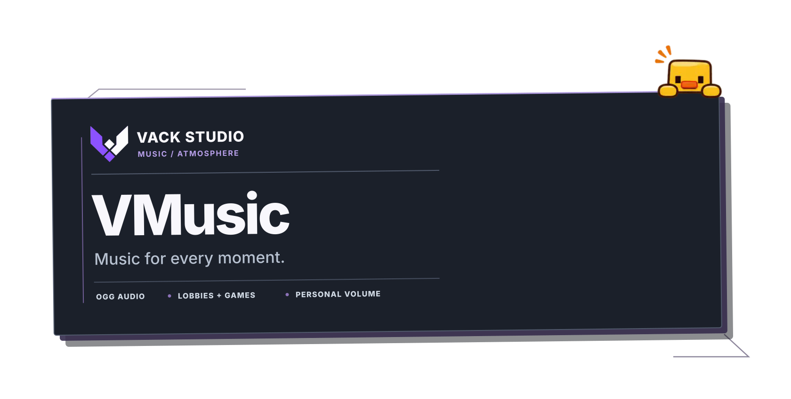
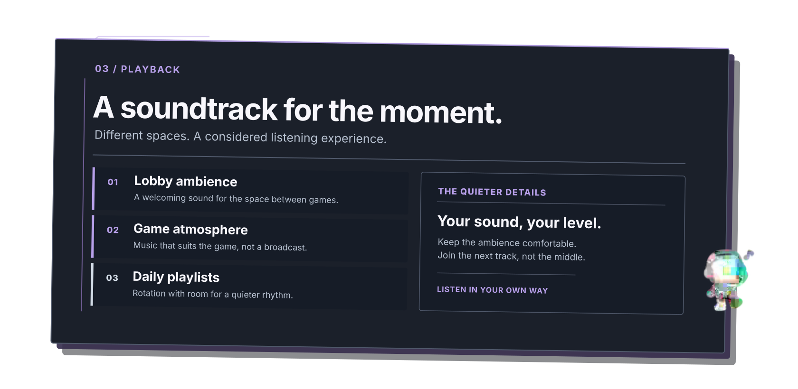
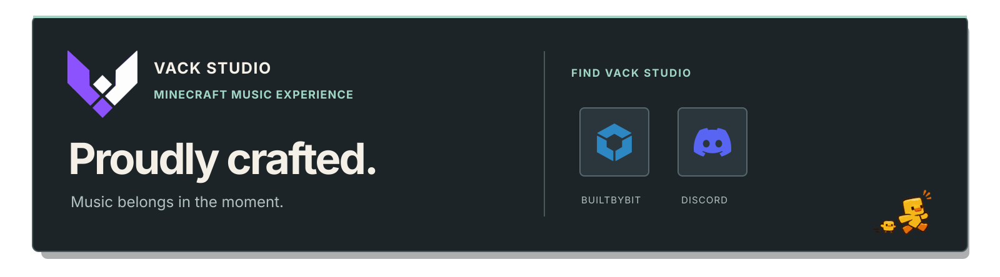

  

# VMusic 

**Music for every moment.**

A world has its own sound. The lobby feels different from the start of a match, and a quiet waiting room deserves a different mood from an active game. **VMusic** is a Minecraft music project by **VACK STUDIO**, designed around those moments.

The direction is deliberately restrained: music should complement Minecraft, not compete with it.

> [!IMPORTANT]
> **Commercial project showcase.** This public repository is a presentation of VMusic, not a distribution of its source code or an installable JAR. Feature descriptions below are design goals unless verified by a public release.

## Music that belongs to the world 

**The same server. Different moods.** 

VMusic is designed around audio contexts, rather than a single track playing everywhere. A lobby can feel welcoming, a game can have a different tempo, and background music can stay quiet enough to let Minecraft's own sounds breathe.
 
The intended workflow uses **OGG audio** and playlists organized by experience. Music playback, integration and version compatibility must still be verified against an actual build before being described as shipped features.

## A soundtrack for the moment 

  

| The moment | VMusic design direction |
| :--- | :--- |
| **Arriving in the lobby** | A welcoming, low-volume background atmosphere |
| **Joining a game** | Music associated with the game instead of the main lobby |
| **Waiting for the next song** | Late joiners synchronize at the next track |
| **Choosing a comfortable level** | Global defaults with per-player volume preferences |
| **Changing the atmosphere** | Planned playlist schedules, including an Asia/Riyadh daily route |

*The visual above is an editorial illustration, not an in-game UI screenshot. The behaviors in this table are planned design requirements, not a claim of runtime acceptance.*

## Set the mood, not the volume 

  

A good soundtrack feels like part of the world. For music preparation, start with these simple principles:

- **Choose audio you can use.** Prepare properly licensed OGG files, keeping the sources and licensing information documented.
- **Give each space a reason to sound different.** Avoid making every lobby, waiting room and game feel identical.
- **Keep the level comfortable.** Background music should never drown out gameplay or essential sounds.
- **Test the transitions.** Check entry, game changes, late joins, and the switch to the next song.

**Mini Zoiila's soundcheck** 

Give each playlist a clear purpose. Keep a record of audio licenses, and compare how the same track feels in a quiet lobby and during active gameplay before settling on its volume.

The public repository does not currently provide a verified configuration reference, so this page intentionally avoids unsupported commands or copy-and-paste installation instructions.

## Project information

| Item | Publicly documented state |
| --- | --- |
| Developer | **VACK STUDIO** |
| Distribution | Proprietary, shared privately with authorization |
| Music source format | OGG — intended workflow |
| Server and Java requirements | Not verified for public release |
| Runtime playback acceptance | Not established from public files |

If you're evaluating VMusic for a server, ask for the tested build version and documented setup requirements before deployment.

## Access and licensing

**VMusic is a commercial VACK STUDIO project.** Contact the studio through its official channels for availability, license terms and release information.

---

  

  
  &nbsp;&nbsp;&nbsp;&nbsp;
  

<strong>License &amp; artwork credits</strong>

Copyright © 2026 VACK STUDIO. All rights reserved.

VMusic, its presentation art and documentation are proprietary. Redistribution of proprietary source or builds requires authorization. Third-party software and assets retain their own rights.

The VACK logo and original Zoiila/Chick signature are carried over from the VACK STUDIO project showcase. The music-themed Mini Zoiila emojis are decorative artwork for this draft README. Mascot poses are reserved for the first (hero) banner; the interior banners remain editorial diagrams without mascot poses. The banners illustrate the product direction; they do not document unverified software functionality.

