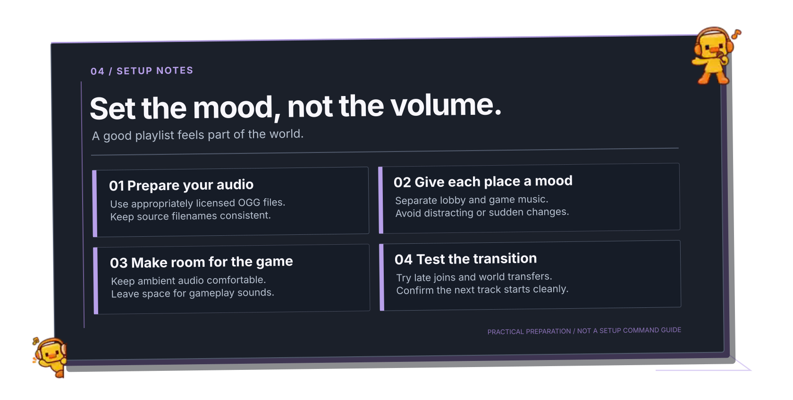
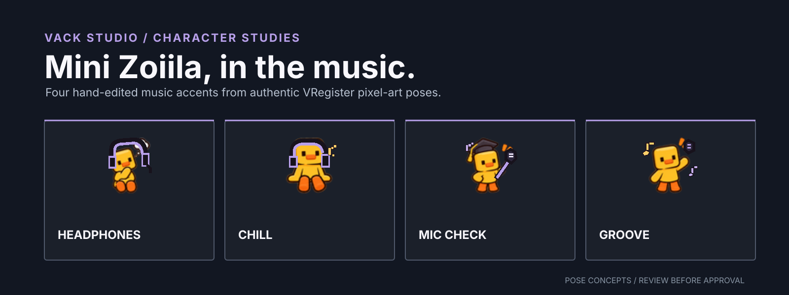

  

# VMusic 

**Music for every moment.**

Minecraft has a rhythm of its own. **VMusic** is a VACK STUDIO music project designed around the spaces between the action: welcoming lobbies, game sessions and the quieter moments that make a server feel like a place.

Rather than turning a server into a radio station, the goal is to give each experience an atmosphere that feels natural, with room for the game itself.

> [!IMPORTANT]
> **Private commercial project.** This public repository is a product-design showcase. Source code and installable builds are not distributed here. The concepts shown below describe the intended VMusic experience; feature availability and compatibility have **not** been verified from a public release.

## A different sound for every space

**The lobby should sound like the lobby. The game should sound like the game.**

VMusic's design centers on music associated with where players are and what they are doing. A calm waiting area can have a different character from an active match, without overwhelming Minecraft's native sounds.

The project direction calls for OGG audio, separate music contexts for lobby and games, and playlists that can change throughout the day. These are product goals, not an announcement that every feature is already shipping.

## Listening shaped around gameplay 

  

| Experience | Design direction |
| --- | --- |
| **Lobby ambience** | A soundtrack that feels at home in the main lobby. |
| **Game atmosphere** | Music choices appropriate for individual game experiences. |
| **Playlist rotation** | Music collections and an intended daily schedule using the Asia/Riyadh time zone. |
| **Late joiners** | A planned next-track synchronization approach rather than dropping a player midway into a song. |
| **Player controls** | Global volume defaults with individual player preferences. |

*The playback illustration is an editorial concept, not a screenshot of an implemented Minecraft interface.*

## Preparing music and useful tips

  

**A few notes from Mini Zoiila** 

- **Start with licensed audio.** Prepare OGG files that you have permission to use and distribute.
- **Think in locations.** Make the lobby, waiting room and each game feel distinct without forcing a track to play constantly.
- **Keep playback comfortable.** Quiet background music works better than a loud, repetitive loop.
- **Test the edges.** Check late joins, changes between worlds, game entry and the transition to the next song.

No setup commands are listed here because the public repository does not provide a verified, version-matched configuration reference.

## Mini Zoiila — music poses

  

These are **hand-edited pixel-art variations** built on the authentic Mini Zoiila artwork. Music headphones, a relaxed listening pose, a microphone soundcheck and a lively groove give this project character without introducing a new mascot, fabricated record logo or decorative music discs.

The pose artwork is presented for visual review; it is not an in-game feature screenshot.

## Status and requirements

| Item | Current public status |
| --- | --- |
| Source and installable JAR | Not published in this repository |
| Publicly verified VMusic version | Not established |
| Verified Paper and Java versions | Not established |
| OGG-based audio workflow | Design direction; not independently release-verified |
| Music integration and playback behavior | Needs runtime verification |

VMusic's compatibility and install instructions should be updated from an actual tested build before publication as a production-ready plugin.

## Access and licensing

VMusic is a proprietary VACK STUDIO project. For product access, licensing and release information, use the studio's official channels.

---

  

  
  &nbsp;&nbsp;&nbsp;&nbsp;
  

<strong>License and rights — VACK STUDIO</strong>

Copyright © 2026 VACK STUDIO. All rights reserved.

VMusic, its original presentation art and documentation are proprietary. Source code and builds require authorization. Third-party assets retain their own licenses. Mini Zoiila's base pixel-art poses, the VACK brand artwork, the signature, and the social icons were reused from the owner's VRegister showcase. Music-themed edits were drawn on top of the original poses.

